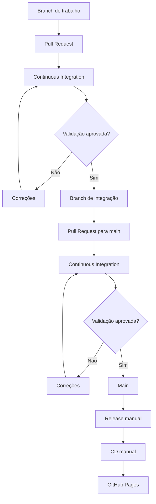

# CI/CD | nando.dev\_

Documentação do fluxo de desenvolvimento,
versionamento, validação e publicação do portfólio.

## 1. Estratégia de branches

| Branch       | Responsabilidade                |
| ------------ | ------------------------------- |
| main         | Código aprovado para publicação |
| alpha/0.10.0 | Integração da versão alpha      |
| feat/\*      | Novas funcionalidades           |
| fix/\*       | Correções                       |
| chore/\*     | Infraestrutura e manutenção     |
| docs/\*      | Documentação                    |
| refactor/\*  | Refatoração de código           |

As branches de trabalho são criadas conforme
a necessidade de cada alteração.

### Fluxo de desenvolvimento



## 2. Convenção de commits

O projeto utiliza Conventional Commits.

Formato:

    tipo(escopo): descrição

Exemplos:

    feat(app): implementação das páginas
    fix(ui): correção de acessibilidade
    chore(infra): configuração da pipeline
    docs(project): atualização da documentação

Os commits devem possuir escopo definido.

## 3. Versionamento

O projeto utiliza Semantic Versioning (SemVer).

    MAJOR.MINOR.PATCH-PRERELEASE

Versão inicial:

    0.10.0-alpha.1

Tag correspondente:

    v0.10.0-alpha.1

Exemplos de evolução:

    0.10.0-alpha.1
    0.10.0-alpha.2
    0.10.0-beta.1
    0.10.0-rc.1
    0.10.0

O avanço entre fases depende da maturidade
e da validação da aplicação.

O package.json e o package-lock.json devem
manter a mesma versão.

Para incrementar uma versão alpha:

```bash
npm version prerelease --preid=alpha --no-git-tag-version
```

As tags de release são gerenciadas pelo workflow
de versionamento.

## 4. Continuous Integration

Arquivo: `.github/workflows/ci.yml`

Eventos:

- Push na main.
- Pull Request.
- Execução manual.

Ambiente:

- Ubuntu.
- Node.js 24.
- Permissões de leitura.

### Repository Validation

Responsabilidades:

- Conferência das versões dos arquivos de pacote.
- Instalação das dependências pelo lockfile,
  sem execução de scripts de instalação.
- Auditoria das dependências de produção.
- Identificação dos arquivos versionados em app/.

### Application Quality

Executado quando o diretório app/ contém
arquivos versionados.

Responsabilidades:

- Instalação das dependências.
- Validação do CSS de temas gerado.
- ESLint.
- TypeScript.
- Build de produção.

Durante a preparação inicial da infraestrutura,
este job podia ser ignorado.

Após a integração da aplicação, ambos os jobs
devem ser executados e aprovados.

## 5. Release

Arquivo: `.github/workflows/release.yml`

Nome: Release | Versioning

Execução exclusivamente manual pela main.

Parâmetro:

| Input   | Valor |
| ------- | ----- |
| confirm | true  |

### Release Validation

- Validação da versão SemVer.
- Conferência do package-lock.json.
- Instalação das dependências.
- Auditoria de segurança.
- Validação dos temas.
- ESLint.
- TypeScript.
- Build de produção.

### Publish GitHub Release

- Utiliza o commit validado.
- Verifica a existência da release.
- Cria a tag correspondente à versão.
- Confere a integridade de uma tag preexistente.
- Gera as notas da release.
- Classifica versões pré-estáveis como prerelease.

A publicação de uma release não executa
automaticamente o deploy.

## 6. Continuous Delivery

Arquivo: `.github/workflows/cd.yml`

Nome: CD | Continuous Delivery

Execução exclusivamente manual pela main.

Parâmetros:

| Input       | Valor de exemplo |
| ----------- | ---------------- |
| release_tag | v0.10.0-alpha.1  |
| publish     | true             |

### Production Build

- Verifica a existência da GitHub Release.
- Valida a ancestralidade da tag na main.
- Utiliza o commit correspondente à tag.
- Confere a versão dos arquivos de pacote.
- Valida o número comercial.
- Configura o GitHub Pages.
- Instala e audita as dependências.
- Valida os temas.
- Executa ESLint e TypeScript.
- Gera a exportação estática.
- Verifica e envia o artefato de produção.

### Production Deployment

- Recebe o artefato validado.
- Utiliza o ambiente github-pages.
- Publica os arquivos estáticos.
- Disponibiliza a URL da publicação.

## 7. Variáveis de ambiente

| Variável                        | Responsabilidade                 |
| ------------------------------- | -------------------------------- |
| NEXT_PUBLIC_WHATSAPP_NUMBER     | Contato comercial                |
| NEXT_PUBLIC_ENABLE_THEME_EDITOR | Editor visual em desenvolvimento |
| NEXT_PUBLIC_ENABLE_UX_TOOLS     | Ferramentas de revisão UX        |
| DEPLOY_TARGET                   | Destino de publicação            |
| PAGES_BASE_PATH                 | Prefixo da aplicação             |
| NEXT_PUBLIC_BASE_PATH           | Prefixo dos recursos públicos    |

O workflow de CD define DEPLOY_TARGET como
github-pages e desativa as ferramentas de
desenvolvimento.

Os prefixos são obtidos automaticamente
pela configuração do GitHub Pages.

NEXT_PUBLIC_WHATSAPP_NUMBER deve ser configurada
como variável do repositório.

O valor deve possuir de 10 a 15 dígitos,
começar com um dígito diferente de zero
e incluir código do país e DDD.

Variáveis NEXT_PUBLIC são públicas no build.
Não devem conter informações secretas.

## 8. Segurança

Diretrizes do repositório:

- Pull Requests para integração na main.
- Histórico linear.
- Rebase and merge.
- Bloqueio de force-push na main.
- Proteção contra exclusão da main.
- Proteção das tags de release.
- Dependabot.
- Auditoria de dependências.
- Permissões mínimas nos workflows.
- Actions referenciadas por commit SHA.
- Ambiente de produção restrito à main.

As verificações de CI devem ser exigidas
após sua execução completa e homologação.

## 9. GitHub Pages

Configuração:

    Settings > Pages > Source > GitHub Actions

Ambiente:

    Settings > Environments > github-pages

A aplicação utiliza exportação estática do Next.js
para publicação no GitHub Pages.

Diretório de saída:

    out/

A aplicação publicada não depende de um servidor
Next.js em execução.

## 10. Validação local

```bash
npm ci
npm run sync:themes
npm run lint
npm run typecheck
npm run build
```

Ainda não há uma suíte de testes automatizados
registrada no package.json.

A homologação visual e comportamental deve
complementar as validações automatizadas.

## 11. Rollback

Em caso de regressão:

1. Identificar uma release anterior homologada.
2. Executar o workflow de CD.
3. Informar a tag da release anterior.
4. Confirmar a publicação.
5. Validar a aplicação publicada.

O rollback de publicação não altera o histórico
da main nem modifica tags anteriores.

Na primeira publicação, ainda não haverá uma
release anterior disponível para rollback.

## 12. Documentos relacionados

- [README](../README.md)
- [Changelog](../CHANGELOG.md)
- [Segurança](../.github/SECURITY.md)

---

nando.dev\_ | Continuous Development
